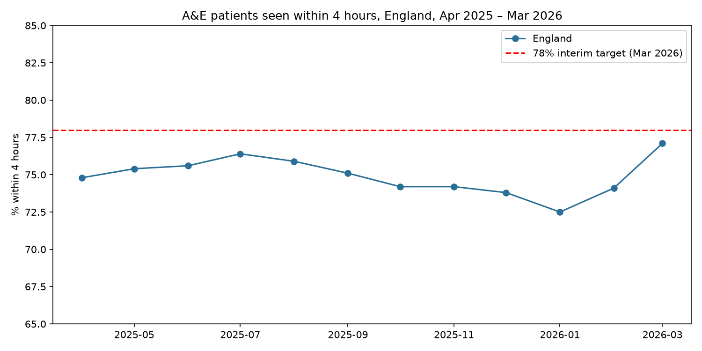
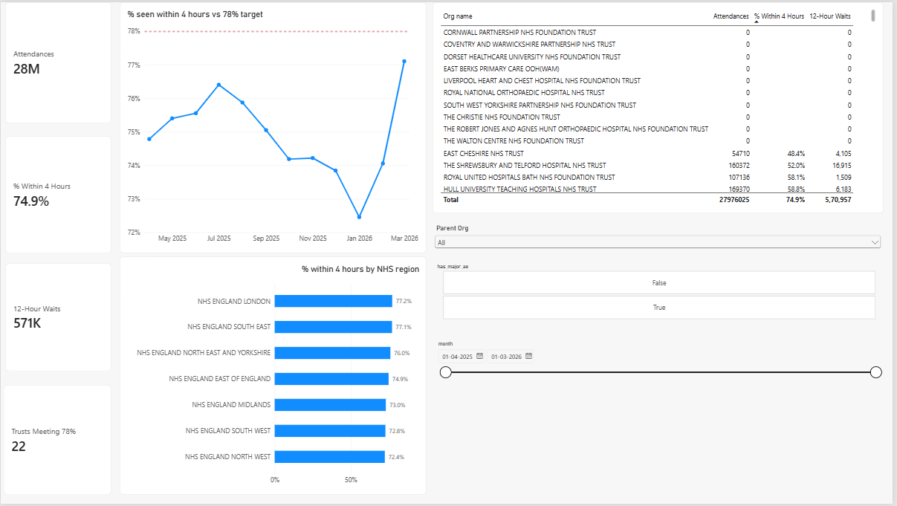

# NHS A&E Four-Hour Performance Analysis (2025/26)

Analysis of NHS England A&E performance against the four-hour standard across 12 months (April 2025 – March 2026): national trend, winter pressure, regional variation and trust-level performance.

## Business questions

1. Did England meet the 78% interim four-hour target in 2025/26, and which months were worst?
2. How much does winter pressure increase 12-hour waits for admission?
3. How does performance vary by NHS region?
4. Which hospital trusts perform best and worst, compared fairly?

## Data

**Real, published data:** NHS England [A&E Attendances and Emergency Admissions 2025-26](https://www.england.nhs.uk/statistics/statistical-work-areas/ae-waiting-times-and-activity/ae-attendances-and-emergency-admissions-2025-26/), monthly CSV files, April 2025 – March 2026 (12 files, ~200 organisations per month, 2,386 rows after cleaning).

## Approach

| Step | File | What it does |
| --- | --- | --- |
| 1 | `01_explore_data.ipynb` | Inspects file structure, columns and A&E types |
| 2 | `02_clean_data.ipynb` | Combines 12 monthly files, reconciles totals against NHS England's published TOTAL rows, removes TOTAL rows, strips whitespace, converts text periods to dates, adds total and percentage columns |
| 3 | `03_analysis.ipynb` | National monthly trend, 12-hour waits, regional comparison, trust ranking (major A&E only) |
| 4 | `04_sql_analysis.ipynb` | Recalculates results in SQL and adds trusts below 60% (HAVING) and best trust per region (CTE + RANK window function) |
| 5 | `ae_dashboard.pbix` | Interactive Power BI dashboard |

## Power BI dashboard

KPI cards, monthly trend against the 78% target, regional comparison, trust table, and slicers for region, major A&E only and month.

## Key findings

1. **England missed the 78% interim target in every month of 2025/26.** All A&E types ranged from 72.5% (January 2026) to 77.1% (March 2026), against the 95% constitutional standard.
2. **Winter roughly doubles 12-hour waits:** patients waiting 12+ hours from decision to admit peaked at 71,517 in January 2026, compared with about 35,000 in summer.
3. **The headline figure flatters major hospitals.** Including walk-in centres, England scored 74.9% for the year; major A&E departments alone scored 72.5%. The weakest region changes from the North West (all types, 72.4%) to the Midlands (major A&E only, 69.2%).
4. **Only 22 of 121 trusts with a major A&E reached 78% across the year.** The lowest was East Cheshire (48.4%). The highest were children's hospitals, which are not directly comparable with general A&Es.
5. **The 4-hour score and 12-hour waits tell different stories.** London had the best 4-hour performance but the third-highest 12-hour waits, suggesting bed availability is a separate problem from front-door speed.

## Method notes

- Percentages are calculated from summed attendances, not averaged across organisations, so larger departments carry proportionate weight.
- Trust comparisons include only organisations with Type 1 (major) A&E activity, grouped by organisation code to handle trust name changes.
- All figures were reconciled against NHS England's published totals and cross-checked between pandas, SQL and Power BI.

## Limitations

- Monthly aggregate data only, with no patient-level detail, so the causes of delays (bed occupancy, staffing, discharge delays) can't be measured directly.
- One financial year only; a longer time series would show whether winter patterns are consistent.
- Children's and specialist hospitals sit in the same dataset as general A&Es and need care when comparing.

## Tools

Python (pandas, matplotlib) · SQL (SQLite) · Power BI (DAX) · Jupyter Notebook · Git/GitHub